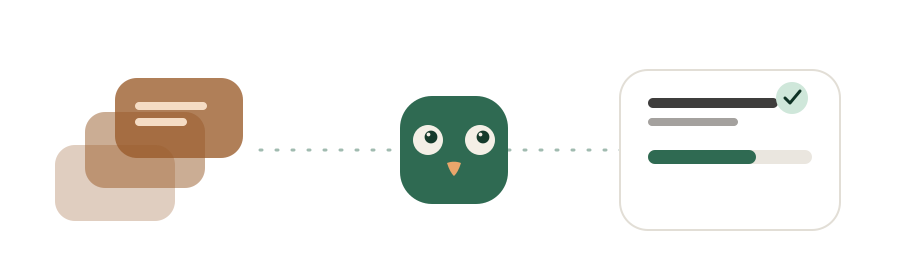
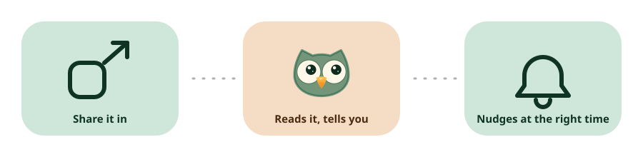

  

<h1 align="center">UpWise</h1>

A personal fix for a very specific bad habit.

---

For years my "learning plan" was a Telegram chat with myself, full of YouTube videos, reels, and articles I *meant* to get to. Some weeks it grew by fifty links. I opened maybe three. Saving something felt like progress, so I never had to ask whether I'd actually learn it.

UpWise is what I built to stop doing that. Share a link from YouTube or Instagram, or paste one — it gets read, not just filed. It tells you what it actually teaches, how long it *really* takes, and nudges you at the times you tend to learn, like a friend keeping you honest.

  

## What it does

- **Reads before it saves.** Videos, reels, and articles get an honest one-line summary and a realistic time estimate — not the raw video length.
- **Knows a bookmark from something to learn.** A plain website link is just kept, no AI involved; a video or article gets the full treatment.
- **Nudges at the times you actually learn**, with quick actions right in the notification — nothing to open just to dismiss.
- **Never lets a zero-effort tap count as "learned."** Marking something done always asks for an honest few minutes.
- **Knows when to leave you alone.** Take a break and the streak goes neutral instead of punishing you.
- **Celebrates the wins**, in the app, differently every time.

One phone, one laptop, one account — built for me, to actually use.

## Design

Material 3's tonal system — one sage accent, one warm accent, surfaces that step by tone instead of borders, no stock icons. An owl for a brand mark.

## Built with

Tauri (Rust + React/TypeScript) for one codebase across Windows and Android, Supabase for data, Groq for the AI.
